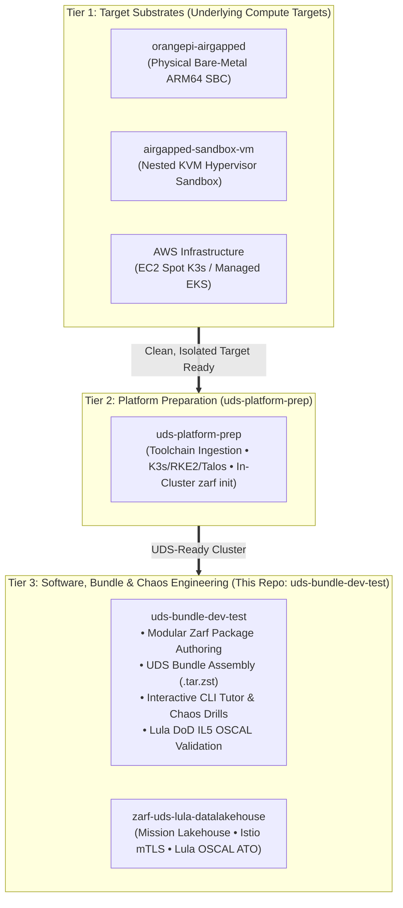

# UDS Bundle Development, Compliance & CLI Troubleshooting Lab (`uds-bundle-dev-test`)

[](#)
[](#)
[](#)
[](#)
[](#)

A developer workspace and **interactive CLI troubleshooting & chaos laboratory** for authoring, packaging, deploying, and diagnosing **Defense Unicorns UDS Bundles**, **Zarf Packages**, **Kubernetes Workloads**, and **Lula OSCAL Compliance Controls** across an air-gap barrier.

In an air-gapped delivery model, implementation layers are cleanly decoupled:
* **Tier 1 (Substrate Layer):** Provisions the isolated hardware or VM compute target ([`orangepi-airgapped`](https://github.com/celttechie/orangepi-airgapped) / [`airgapped-sandbox-vm`](https://github.com/celttechie/airgapped-sandbox-vm)).
* **Tier 2 (Platform Prep Layer):** Prepares that target with the offline Kubernetes runtime and runs `zarf init` to stand up the in-cluster registry ([`uds-platform-prep`](https://github.com/celttechie/uds-platform-prep)).
* **Tier 3 (Bundle & Interactive Troubleshooting Layer):** This repository. It authors modular `zarf.yaml` packages with automated SBOM generation, aggregates them into top-level `uds-bundle.yaml` bundles, validates DoD IL5 OSCAL compliance via `lula`, and provides an **Interactive CLI Troubleshooting Tutor & Chaos Engine** (`scripts/drill_manager.py`) to practice `kubectl`, `zarf`, `uds`, and `lula` diagnostics.

---

## 3-Tier Layered Hierarchy



For the architectural rationale, see [ADR 0001: Separation of Environment Infrastructure and UDS Bundle Lifecycles](file:///home/bjarrett/Projects/uds-bundle-dev-test/docs/adr/0001-separation-of-environment-and-bundle-lifecycle.md).

---

## Directory Structure

```
uds-bundle-dev-test/
├── .github/
│   └── workflows/
│       └── ci.yml                  # GitHub Actions CI: Lula lint, KinD runtime gate, unit tests, Gitleaks
├── bundles/                        # Top-level UDS bundle definitions
│   ├── uds-bundle.yaml             # Bundle orchestrating Zarf packages & dependencies
│   └── zarf.yaml                   # Demo / local package definition
├── packages/                       # Modular Zarf packages (argocd, monitoring, training-app)
├── scripts/                        # Build, compliance, and chaos/tutor automation
│   ├── common.py                   # KUBECONFIG discovery, SSH tunnel auto-recovery & runner
│   ├── drill_manager.py            # Interactive CLI Tutor & Chaos Injection Engine
│   ├── build-bundle.sh             # Builds Zarf packages and creates .tar.zst bundle
│   ├── test-deploy.sh              # Deploys the compiled UDS bundle to target cluster
│   ├── test-compliance.sh          # Runs Lula OSCAL IL5 compliance validation
│   └── verify-airgap.sh            # Audits network isolation / zero egress (auto-delegates via SSH)
├── docs/                           # Architecture decision records, OSCAL, & drill runbooks
│   ├── adr/                        # Architectural Decision Records (0001–0003)
│   ├── compliance/                 # NIST SP 800-53 Rev 5 OSCAL 1.1.2 component & assessment
│   │   ├── oscal-il5.yaml
│   │   └── assessment-results.yaml
│   ├── design/                     # Platform bundle architectural specifications
│   └── troubleshooting-drills/     # 4-Phase CLI Diagnostic Field Manual
├── tests/                          # Automated unit, OSCAL schema, and shift-left IL5 test suite
├── Makefile                        # Unified CLI workflow entrypoint
└── README.md
```

---

## Quick Start: Build, Deploy & Validate Compliance

```bash
# 1. View all available Make targets
make help

# 2. Run local linting gates (ShellCheck, Python syntax, YAML, and Lula OSCAL linting)
make lint

# 3. Run automated unit, schema, and shift-left DoD IL5 compliance assertions
make test

# 4. Build modular Zarf packages and assemble the UDS bundle (.tar.zst)
make build

# 5. Verify strict zero-egress air-gap isolation and deploy the UDS bundle
make verify-airgap
make deploy

# 6. Check remote cluster status (nodes, pods, and services)
make status

# 7. Validate live cluster state against DoD IL5 NIST 800-53 controls using Lula
make compliance
```

---

## 🔒 Automated CI/CD & Defense Unicorns Lula Compliance Architecture

This repository implements Defense Unicorns' recommended **3-tier automated compliance and quality architecture** across GitHub Actions ([`.github/workflows/ci.yml`](file:///home/bjarrett/Projects/uds-bundle-dev-test/.github/workflows/ci.yml)) and local toolchains:

1. **Tier 1 — Shift-Left Schema & Model Linting (`make lint` / CI):**
   * Validates OSCAL `component-definition` and `assessment-results` models against the official NIST schema using `lula tools lint`.
   * Lints bash automation scripts with `shellcheck` and Python modules with `ruff` and `py_compile`.
   * Scans for committed secrets with `gitleaks`.
2. **Tier 2 — Static Manifest Compliance Assertions (`make test` / CI):**
   * Statically audits all `packages/training-app/manifests/*.yaml` for NIST SP 800-53 controls:
     * **AC-3 (Least Privilege):** Verifies all containers enforce `securityContext.allowPrivilegeEscalation: false`.
     * **AC-4 (Information Flow):** Verifies zero-trust `NetworkPolicy` ingress and egress enforcement.
     * **SC-8 & CM-8:** Audits service definitions, component namespaces, and confirms baseline assessment findings are satisfied.
3. **Tier 3 — Ephemeral KinD Runtime Compliance Gate (CI) & Disconnected Live Cluster (CD):**
   * **In CI:** Spins up an ephemeral Kubernetes cluster (`kind-action`), deploys workload manifests, and runs live `lula validate -f docs/compliance/oscal-il5.yaml` against the running Kubernetes API, failing the build on any control regression.
   * **In Field / Air-Gap:** Runs live compliance validation against the target cluster (`make compliance`) and continuous triage through `make drill-check`.

---

## 🧪 Interactive CLI Troubleshooting Tutor & Chaos Lab

Once the UDS bundle is deployed, use the built-in **Drill Manager** ([`scripts/drill_manager.py`](file:///home/bjarrett/Projects/uds-bundle-dev-test/scripts/drill_manager.py)) and [Troubleshooting Runbook](file:///home/bjarrett/Projects/uds-bundle-dev-test/docs/troubleshooting-drills/README.md) to practice diagnosing and fixing cluster, Zarf, UDS, and Lula compliance issues using real CLI commands:

```bash
# 1. View all 10 chaos & troubleshooting scenarios
make drill-list

# 2. Print the kubectl, zarf, uds, and lula CLI diagnostic cheat sheet
make drill-cheatsheet

# 3. Launch the interactive 4-phase CLI tutor for a scenario (Detect -> Isolate -> Root Cause -> Remediate)
make drill-tutor SCENARIO=zarf-untracked-image

# 4. Or launch "Blind Mystery Mode" (injects a random fault for you to diagnose & fix!)
make drill-mystery

# 5. Check if your cluster and Lula compliance controls are back to 100% healthy
make drill-check

# 6. Restore all scenarios to a clean, healthy state at any time
make drill-heal SCENARIO=all
```

### Troubleshooting Scenario Catalog

| Domain | Scenario ID | CLI Tools Practiced | Fault Description |
| :--- | :--- | :--- | :--- |
| **Zarf / Air-Gap** | `zarf-untracked-image` | `kubectl`, `zarf` | Patches `order-api` to request an image tag not seeded in the internal Zarf registry (`127.0.0.1:31999`). |
| **Zarf / Air-Gap** | `zarf-webhook-bypass` | `kubectl`, `zarf` | Labels `queue-worker` pod template with `zarf.dev/agent: ignore` so Zarf's mutating webhook is bypassed. |
| **UDS / Networking** | `net-policy-block` | `kubectl`, `uds` | Applies a restrictive `NetworkPolicy` blocking `frontend` $\rightarrow$ `order-api` traffic. |
| **UDS / Networking** | `net-port-mismatch` | `kubectl` | Misconfigures `order-api` Service `targetPort` (`9090` vs `8080`), causing `Connection refused`. |
| **UDS / Networking** | `net-service-endpoint` | `kubectl` | Breaks `order-api` Service label selector, resulting in `<none>` backing Endpoints. |
| **Compute** | `comp-oom-killed` | `kubectl` | Injects a memory leak into `queue-worker` exceeding its 128Mi limit (`OOMKilled` / Exit Code 137). |
| **Compute** | `comp-probe-fail` | `kubectl` | Breaks `order-api` HTTP livenessProbe path (`/healthz-broken-path`), causing HTTP 404 probe kills. |
| **Compute** | `comp-unschedulable` | `kubectl` | Adds an unsatisfiable `nodeSelector` to `order-api`, leaving new pods stuck in `Pending`. |
| **Storage** | `stor-pvc-pending` | `kubectl` | Creates a `PersistentVolumeClaim` requesting a non-existent `StorageClass` (`non-existent-nvme-sc`). |
| **Lula / Security** | `sec-lula-drift` | `lula`, `kubectl` | Patches `order-api` with `allowPrivilegeEscalation: true`, violating NIST 800-53 `AC-3` in [`oscal-il5.yaml`](file:///home/bjarrett/Projects/uds-bundle-dev-test/docs/compliance/oscal-il5.yaml). |
