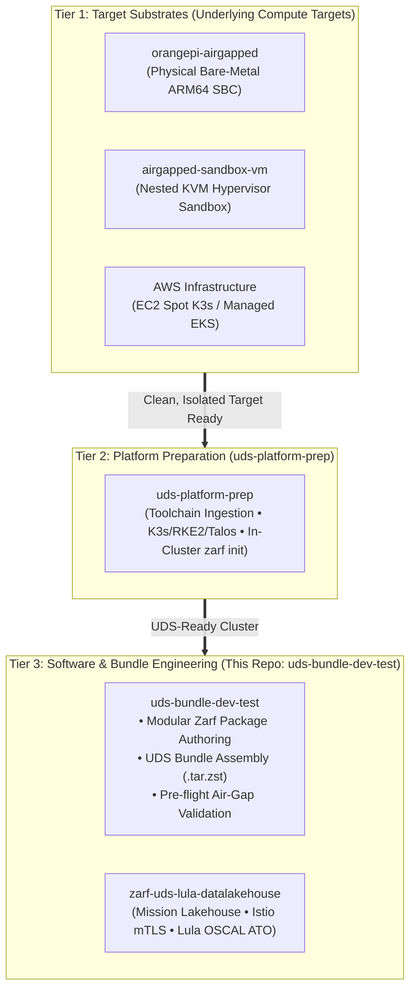

# UDS Bundle Development & Test (`uds-bundle-dev-test`)

[](#)
[](#)
[](#)
[](#)

A dedicated developer workspace for authoring, packaging, and testing **Defense Unicorns UDS Bundles** and **Zarf Packages** on a connected machine before shipping them across the air-gap barrier.

In an air-gapped delivery model, you need a clean separation of implementation layers:
* **Tier 1 (Substrate Layer):** Provisions the isolated hardware or VM compute target ([`orangepi-airgapped`](https://github.com/celttechie/orangepi-airgapped) / [`airgapped-sandbox-vm`](https://github.com/celttechie/airgapped-sandbox-vm)).
* **Tier 2 (Platform Prep Layer):** Prepares that target with the offline Kubernetes runtime and runs `zarf init` to stand up the in-cluster registry ([`uds-platform-prep`](https://github.com/celttechie/uds-platform-prep)).
* **Tier 3 (Bundle & Workload Layer):** This repository. It authors modular `zarf.yaml` packages with automated SBOM generation, aggregates them into top-level `uds-bundle.yaml` bundles, and compiles self-contained `.tar.zst` artifacts.

The resulting Tier 3 bundles are deployed directly onto the target system that was prepared by Tier 2 on top of Tier 1 infrastructure, executing `uds deploy` with zero external dependencies.

---

## 3-Tier Layered Hierarchy



For the architectural rationale, see [ADR 0001: Separation of Environment Infrastructure and UDS Bundle Lifecycles](file:///home/bjarrett/Projects/uds-bundle-dev-test/docs/adr/0001-separation-of-environment-and-bundle-lifecycle.md).

---

## Directory Structure

```
uds-bundle-dev-test/
├── bundles/                # Top-level UDS bundle definitions
│   ├── uds-bundle.yaml     # Bundle orchestrating Zarf packages & dependencies
│   └── zarf.yaml           # Demo / local package definition
├── packages/               # Modular Zarf packages (apps, services, tools)
├── scripts/                # Development, build, and validation scripts
│   ├── build-bundle.sh     # Builds Zarf packages and creates .tar.zst bundle
│   ├── test-deploy.sh      # Tests deploying the bundle to a cluster
│   └── verify-airgap.sh    # Audits network isolation / zero egress
├── docs/                   # Architecture decision records & guides
│   └── adr/
│       └── 0001-separation-of-environment-and-bundle-lifecycle.md
└── README.md
```

---

## Getting Started

### Prerequisites (Connected Machine)
- [UDS CLI](https://github.com/defenseunicorns/uds-cli) (`uds`)
- [Zarf CLI](https://github.com/zarf-dev/zarf) (`zarf`)
- [Lula CLI](https://github.com/defenseunicorns/lula) (optional, for compliance validation)
- Docker or Podman (for packaging container images)

### 1. Build the UDS Bundle
Run the build script on your connected workstation to package all container images and manifests into a single offline artifact:
```bash
./scripts/build-bundle.sh
```
The compiled bundle (`uds-bundle-<name>-<arch>-<version>.tar.zst`) will be generated in `build/`.

### 2. Deliver and Deploy to Air-Gapped Sandbox
Transfer the generated `.tar.zst` artifact to the target air-gapped test environment (e.g., your Dell T5600 sandbox node) and run:
```bash
uds deploy ./build/uds-bundle-*.tar.zst --confirm
```

---

## Testing & Verification

- **Air-Gap Network Audit**: Run `./scripts/verify-airgap.sh` inside the target VM to assert zero WAN egress prior to deployment.
- **Cluster Deployment Test**: Run `./scripts/test-deploy.sh` against the active `KUBECONFIG`.
