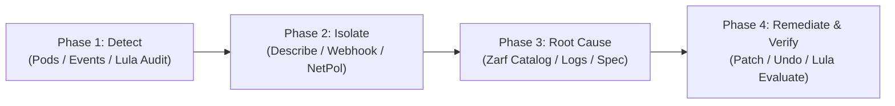

# Air-Gapped Defense Unicorns & Kubernetes CLI Troubleshooting Guide

Welcome to the **Air-Gapped Platform Engineering & Troubleshooting Laboratory**. This guide pairs with [`scripts/drill_manager.py`](file:///home/bjarrett/Projects/uds-bundle-dev-test/scripts/drill_manager.py) to provide hands-on practice with **`kubectl`**, **`zarf`**, **`uds`**, and **`lula`** across realistic failure modes in disconnected environments.

---

## 1. The 4-Phase Diagnostic Protocol

Every interactive tutor session (`make drill-tutor SCENARIO=<id>`) walks you through a structured 4-phase incident response loop:

---

## 2. Quick-Start Drill Modes

| Mode | Command | How It Works |
| :--- | :--- | :--- |
| **Catalog** | `make drill-list` | Lists all 10 scenarios across Zarf, UDS/Networking, Compute, Storage, and Lula Security. |
| **Cheat Sheet** | `make drill-cheatsheet` | Prints a quick-reference card of `kubectl`, `zarf`, `uds`, and `lula` diagnostic commands. |
| **Guided CLI Tutor** | `make drill-tutor SCENARIO=<id>` | Injects the fault and prompts you step-by-step through Phases 1–4. Type any CLI command to run it live, or type `hint`, `run`, `explain`, `next`, or `heal`. |
| **Blind Mystery Mode** | `make drill-mystery` | Injects a random scenario without telling you which one broke. Diagnose it using the CLIs and run `make drill-check` when fixed! |
| **Health & ATO Check** | `make drill-check` | Audits pod readiness, Service endpoints, PVCs, and Lula OSCAL compliance (`REVEAL=1` reveals active mystery). |
| **Reset / Heal All** | `make drill-heal SCENARIO=all` | Restores all deployments, services, network policies, and security contexts to a clean state. |

---

## 3. Scenario Reference & Walkthroughs

### Domain 1: Zarf & Air-Gap Registry (`zarf` + `kubectl`)

#### `zarf-untracked-image` — Unseeded Container Image Tag in Air-Gap
* **Fault Injected:** Updates `order-api` image to `python:3.11-unseeded-airgap`, which does not exist in the in-cluster Zarf registry (`127.0.0.1:31999`).
* **Diagnostic Walkthrough:**
  1. **Detect:** `kubectl get pods -n training-app -o wide` $\rightarrow$ Spot `ErrImagePull` / `ImagePullBackOff`.
  2. **Isolate:** `kubectl describe pod -n training-app -l app=order-api` $\rightarrow$ Note Zarf rewrote the image to `127.0.0.1:31999/library/python:3.11-unseeded-airgap`, returning `manifest unknown`.
  3. **Root Cause:** `zarf tools registry catalog` and `zarf tools registry ls library/python` $\rightarrow$ Confirm only `3.11-alpine` is seeded in the air-gap registry.
  4. **Remediate:** `kubectl set image deployment/order-api order-api=python:3.11-alpine -n training-app`.

#### `zarf-webhook-bypass` — Zarf Mutating Webhook Bypassed (`zarf.dev/agent=ignore`)
* **Fault Injected:** Adds label `zarf.dev/agent: ignore` and `imagePullPolicy: Always` to `queue-worker` pod template.
* **Diagnostic Walkthrough:**
  1. **Detect:** `kubectl get pods -n training-app -l app=queue-worker` $\rightarrow$ Pod stuck in `ImagePullBackOff`.
  2. **Isolate:** `kubectl describe pod -n training-app -l app=queue-worker` and `kubectl logs -n zarf -l app=agent-hook --tail=20` $\rightarrow$ Kubelet is attempting to pull from `registry-1.docker.io` across the air-gap instead of `127.0.0.1:31999`.
  3. **Root Cause:** `kubectl get deploy queue-worker -n training-app -o jsonpath='{.spec.template.metadata.labels}'` $\rightarrow$ Reveals `"zarf.dev/agent":"ignore"`.
  4. **Remediate:** `kubectl rollout undo deployment/queue-worker -n training-app`.

---

### Domain 2: UDS Bundle & Kubernetes Networking (`uds` + `kubectl`)

#### `net-policy-block` — Zero-Trust NetworkPolicy Ingress Block
* **Fault Injected:** Applies `NetworkPolicy` `deny-order-api-ingress` selecting `app: order-api` and only allowing ingress from `app: nonexistent-service`.
* **Diagnostic Walkthrough:**
  1. **Detect:** `kubectl get pods,svc -n training-app` $\rightarrow$ All pods show `Running`, yet requests to `order-api` time out.
  2. **Isolate:** `kubectl get netpol -n training-app` $\rightarrow$ Spot `deny-order-api-ingress`.
  3. **Root Cause:** `kubectl describe netpol deny-order-api-ingress -n training-app`.
  4. **Remediate:** `kubectl delete netpol deny-order-api-ingress -n training-app`.

#### `net-port-mismatch` — Service TargetPort Misconfiguration
* **Fault Injected:** Patches `order-api` Service `targetPort` from `8080` to `9090`.
* **Diagnostic Walkthrough:**
  1. **Detect:** `kubectl get svc,ep order-api -n training-app` $\rightarrow$ Endpoints point to `<pod-ip>:9090`.
  2. **Isolate:** `kubectl describe svc order-api -n training-app`.
  3. **Root Cause:** `kubectl get deploy order-api -n training-app -o jsonpath='{.spec.template.spec.containers[0].ports}'` $\rightarrow$ Container listens on `8080`.
  4. **Remediate:** `kubectl patch svc order-api -n training-app --type='json' -p='[{"op":"replace","path":"/spec/ports/0/targetPort","value":8080}]'`.

#### `net-service-endpoint` — Service Selector Label Mismatch
* **Fault Injected:** Changes `order-api` Service selector to `app: order-api-wrong-label`.
* **Diagnostic Walkthrough:**
  1. **Detect:** `kubectl get ep order-api -n training-app` $\rightarrow$ `ENDPOINTS` is `<none>`.
  2. **Isolate:** `kubectl describe svc order-api -n training-app` $\rightarrow$ `Selector: app=order-api-wrong-label`.
  3. **Root Cause:** `kubectl get pods -n training-app --show-labels` $\rightarrow$ Pods have `app=order-api`.
  4. **Remediate:** `kubectl patch svc order-api -n training-app -p '{"spec":{"selector":{"app":"order-api"}}}'`.

---

### Domain 3: Kubernetes Compute & Storage (`kubectl`)

#### `comp-oom-killed` — Out Of Memory CrashLoop (Exit Code 137)
* **Diagnostic Commands:** `kubectl get pods -n training-app` $\rightarrow$ `kubectl describe pod -n training-app -l app=queue-worker` (`Last State: Terminated, Reason: OOMKilled, Exit Code: 137`) $\rightarrow$ `kubectl logs -n training-app -l app=queue-worker --previous` $\rightarrow$ `kubectl rollout undo deployment/queue-worker -n training-app`.

#### `comp-probe-fail` — Liveness Probe HTTP 404 Failure Loop
* **Diagnostic Commands:** `kubectl get events -n training-app --sort-by=.metadata.creationTimestamp` (`Liveness probe failed: HTTP probe failed with statuscode: 404`) $\rightarrow$ `kubectl describe deploy order-api -n training-app` $\rightarrow$ Patch `livenessProbe` path back to `/healthz`.

#### `comp-unschedulable` — Unschedulable Pod / NodeSelector Mismatch
* **Diagnostic Commands:** `kubectl get pods -n training-app` (`Pending`) $\rightarrow$ `kubectl describe pod -n training-app -l app=order-api` (`0/1 nodes are available: 1 node(s) didn't match Pod's node affinity/selector`) $\rightarrow$ `kubectl get nodes --show-labels` $\rightarrow$ Remove invalid `nodeSelector`.

#### `stor-pvc-pending` — Unsatisfied StorageClass / Pending PVC
* **Diagnostic Commands:** `kubectl get pvc -n training-app` (`Pending`) $\rightarrow$ `kubectl describe pvc drill-pending-pvc -n training-app` (`storageclass.storage.k8s.io "non-existent-nvme-sc" not found`) $\rightarrow$ `kubectl get sc` $\rightarrow$ `kubectl delete pvc drill-pending-pvc -n training-app`.

---

### Domain 4: Lula Compliance & Security Drift (`lula` + `kubectl`)

#### `sec-lula-drift` — DoD IL5 NIST 800-53 AC-3 Privilege Escalation Drift
* **Fault Injected:** Patches `order-api` container `securityContext` with `allowPrivilegeEscalation: true`, violating control `ac-3` in [`docs/compliance/oscal-il5.yaml`](file:///home/bjarrett/Projects/uds-bundle-dev-test/docs/compliance/oscal-il5.yaml).
* **Diagnostic Walkthrough:**
  1. **Detect:** `lula validate -f docs/compliance/oscal-il5.yaml -o docs/compliance/assessment-results.yaml`
  2. **Isolate:** `lula evaluate -f docs/compliance/assessment-results.yaml` $\rightarrow$ Identify failing observation UUID `c65f7e81-d204-4cc6-93be-1706402f0ff8` (`AC-3 Least Privilege`).
  3. **Root Cause:** `kubectl get deploy -n training-app -o jsonpath='{range .items[*]}{.metadata.name}{": "}{.spec.template.spec.containers[*].securityContext}{"\n"}{end}'` $\rightarrow$ Spot `order-api: {"allowPrivilegeEscalation":true}`.
  4. **Remediate:** Patch `allowPrivilegeEscalation: false` on `order-api` and re-run `lula validate` + `lula evaluate` to confirm 100% pass.
